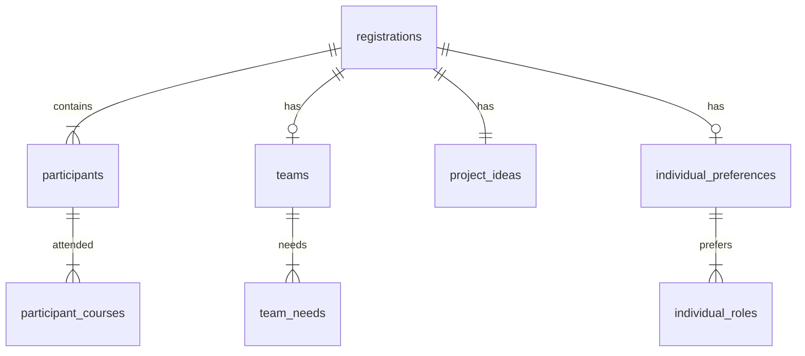

# منصة هاكاثون الهمك

منصة عربية RTL للتعريف والتسجيل في هاكاثون الروبوتيك والذكاء الصنعي — نادي الهمك، جامعة دمشق.
تدعم الفرق الداخلية والخارجية والأفراد، وتُبقي بيانات المشاركين خاصة بالمنظّمين.

## التقنيات والبنية

- React / TypeScript / Vite / Tailwind، React Router، React Hook Form، Zod، Motion، Lucide.
- Express / TypeScript، PostgreSQL على Neon للإنتاج، Drizzle ORM.
- جلسات مخزّنة في PostgreSQL، ExcelJS للتصدير.
- `artifacts/hmk-hackathon`: الواجهة العامة والتسجيل والإدارة.
- `artifacts/api-server/src/routes`: وحدات HTTP.
- `artifacts/api-server/src/services`: الحفظ والقراءة والتصدير.
- `artifacts/api-server/src/lib`: قواعد التحقق وخيارات التسجيل.
- `artifacts/api-server/src/middlewares`: الجلسات، CSRF، وحدود المحاولات.
- خط Minecrafter محلي للأرقام والعناوين اللاتينية؛ لا يغطي الأحرف العربية، لذلك تُعرض العناوين العربية بخط عربي بديل.
- `lib/db/src/schema`: الجداول والعلاقات.
- `lib/db/drizzle`: ملفات SQL التاريخية المُولّدة.
- `lib/api-spec/openapi.yaml`: عقد API، و`lib/api-client-react` و`lib/api-zod`: عملاء وأنواع مولّدة.
- [شرح قاعدة البيانات وERD](docs/database.md).

## التشغيل

Node.js 24 وpnpm. من جذر المشروع:

```sh
pnpm install
pnpm --filter @workspace/db run push
pnpm --filter @workspace/api-spec run codegen
pnpm run typecheck
```

للتشغيل المحلي، وفّر PostgreSQL ومتغيرات البيئة، ثم شغّل الخادم والواجهة مع موجّه محلي يوجّه `/api` إلى منفذ الخادم وبقية المسارات إلى الواجهة:

```sh
PORT=8080 pnpm --filter @workspace/api-server run dev
PORT=5173 BASE_PATH=/ pnpm --filter @workspace/hmk-hackathon run dev
```

لا تُعرّض خادم التطوير للإنترنت في الإنتاج.

## الأسرار

أضف الأسرار في إعدادات مزود الاستضافة، وليس في كود الواجهة أو Git:

| المتغير | الغرض |
|---|---|
| `DATABASE_URL` | رابط Neon المجمّع (Pooled) لتشغيل التطبيق |
| `DATABASE_URL_UNPOOLED` | رابط Neon المباشر لعمليات Drizzle Kit |
| `ADMIN_PASSWORD` | كلمة مرور قوية مشتركة للمنظّمين، بلا قيمة افتراضية |
| `SESSION_SECRET` | قيمة عشوائية قوية لتوقيع الجلسات |

تحقق من توافر هذه الأسرار في بيئة الإنتاج. لا تطبعها أو ترفعها إلى GitHub. تغيير `SESSION_SECRET` يلغي صلاحية الجلسات القائمة.

## مسارات الواجهة

- `/`: تعريف الهاكاثون ودليله والعد التنازلي.
- `/register`: التسجيل المشروط متعدد الخطوات ثم شاشة رقم الطلب.
- `/admin-hmk`: دخول المنظّمين ولوحة البيانات. لا يوجد رابط عام إليها.

الإدارة تتيح الاستعراض والبحث والفلترة والتصدير وحذف الطلب كاملاً فقط.
لا توجد واجهات تعديل، حالات قبول/رفض، ملاحظات إدارية أو توزيع تلقائي للفرق.

## API

جميع المسارات التالية تبدأ بـ `/api`:

| الطريقة والمسار | الوظيفة |
|---|---|
| `GET /healthz` | صحة الخدمة |
| `GET /registration-config` | الموعد النهائي وحالة فتح التسجيل، دون بيانات مشاركين |
| `POST /registrations` | تحقق وحفظ طلب كامل في معاملة واحدة؛ يعيد الرقم المرجعي فقط |
| `GET /admin/session` | جلسة المنظّم ورمز CSRF؛ مسموح قبل الدخول |
| `POST /admin/login` | كلمة مرور عبر الخادم؛ يتطلب CSRF |
| `POST /admin/logout` | إتلاف الجلسة؛ يتطلب الدخول وCSRF |
| `GET /admin/summary` | إحصائيات الطلبات والأشخاص والفرق والأفكار |
| `GET /admin/registrations` | الطلبات الكاملة للمنظّم، والفلترة محلياً داخل لوحة الإدارة |
| `GET /admin/registrations/:id` | تفاصيل طلب |
| `DELETE /admin/registrations/:id` | حذف الطلب وكل توابعه؛ يتطلب CSRF |
| `GET /admin/export/xlsx` | ملف Excel بسبع أوراق |
| `GET /admin/export/csv` | CSV عربي؛ صف لكل شخص مع بيانات الطلب المرتبطة |

رمز CSRF يُرسل في `X-CSRF-Token` ويتغير عند الدخول. تتطلب كل مسارات الإدارة، عدا الجلسة والدخول،
جلسة منظّم صالحة. إعادة الدخول تنشئ معرّف جلسة جديداً.

## التسجيل وقواعده

- الإغلاق: **1 ديسمبر 2026، 23:59:59، Asia/Damascus** (`2026-12-01T23:59:59+03:00`).
- يُفرض الإغلاق على الخادم أيضاً؛ العد لا يعتمد على المنطقة الزمنية المحلية للزائر.
- الفريق من 2 إلى 6 أشخاص شاملاً القائد؛ الأفراد لا يملكون سجلاً وهمياً للفريق.
- الجهات الخارجية فرق فقط، واسم الجهة وفكرة مكتملة إلزاميان.
- وصف الفكرة من 50 إلى 300 كلمة. غياب الفكرة الداخلية يُسجل صراحة `NEEDS_IDEA`.
- التعهدان إلزاميان؛ تاريخ الموافقة من ساعة الخادم.
- لا تُحفظ بيانات شخصية في Local Storage؛ يُستخدم لتفضيل المظهر فقط.
- المواصفات الأحدث تتقدم على الدليل في اختلافات التسجيل: الفرق الخارجية، 50–300 كلمة،
  وحقول التسجيل المحددة دون إضافة الرقم الجامعي. معلومات الدليل غير المحددة لا تُختلق.

## مخطط قاعدة البيانات



الجلسات وحدود المحاولات جداول تشغيلية منفصلة. تفاصيل القيود والمعاملات في [docs/database.md](docs/database.md).

## تحديث المخطط

عدّل تعريفات Drizzle ثم ولّد ملف migration تاريخي وطبّق التغيير باستخدام اتصال مباشر (`DATABASE_URL_UNPOOLED` في Neon):

```sh
pnpm --filter @workspace/db exec drizzle-kit generate --config ./drizzle.config.ts
pnpm --filter @workspace/db run push
```

لا تشغّل تغييرات المخطط عند بدء الخادم ولا داخل بناء الإنتاج. راجع أي تحذيرات حذف أو إعادة تسمية قبل تطبيق التغيير على قاعدة Neon الإنتاجية. تحتفظ ملفات `lib/db/drizzle` بتاريخ SQL؛ `push` هو مسار تطبيق المخطط الحالي في هذا المشروع.

## النشر على Vercel

تم تجهيز المشروع للنشر على Vercel مع Express Function وواجهة Vite ثابتة وقاعدة Neon PostgreSQL. اتبع الدليل التفصيلي: [docs/vercel-deployment-ar.md](docs/vercel-deployment-ar.md).

أمر البناء الخاص بـ Vercel هو `pnpm run vercel:build`. يجب إنشاء جداول Neon مرة واحدة باستخدام `DATABASE_URL_UNPOOLED` قبل تشغيل الموقع. لا تُشغّل migrations تلقائياً أثناء كل Deployment.

## الخصوصية والأمان

- Cookies: `HttpOnly`, `SameSite=Lax`, و`Secure` في الإنتاج؛ مدة الجلسة 8 ساعات.
- CSRF للدخول والخروج والحذف، وتجديد الجلسة بعد الدخول.
- حد الدخول 10 محاولات لكل 15 دقيقة؛ حد التسجيل 20 طلباً لكل ساعة لكل عنوان اتصال.
  العدادات مشتركة بين النسخ عبر PostgreSQL؛ يخزن مفتاح العنوان مجزّأً.
- لا تُسجل كلمات المرور أو أجسام الطلبات أو أخطاء قاعدة البيانات التي قد تتضمن بيانات شخصية.
- ORM ومعاملات وقيم مربوطة؛ لا استعلامات SQL من مدخلات المستخدم.
- بيانات الإدارة `no-store`؛ لا توجد API عامة للاستعراض.
- CSV يحمي من حقن صيغ جداول البيانات؛ أرقام التواصل نصوص في Excel.
- لا تنشر ملفات التصدير للعامة؛ تحتوي على بيانات شخصية.
- واجهة الإدارة ليست محمية بمجرد إخفاء رابطها؛ الخادم يفرض المصادقة لكل مسار خاص.
- لا تشارك كلمة مرور المنظّمين إلا مع المخوّلين؛ لا توجد إدارة حسابات متعددة في هذا الإصدار.

## النسخ الاحتياطي والاسترجاع

استخدم إمكانيات النسخ الاحتياطي والاسترجاع التي توفرها خطة Neon المفعّلة. تحقق من نافذة الاحتفاظ وإعدادات الاسترجاع في لوحة Neon قبل استقبال التسجيلات. ملفات Excel/CSV تصدير للبيانات وليست بديلاً عن نسخة احتياطية كاملة لقاعدة البيانات.

مراجع: راجع إعدادات النسخ الاحتياطي والاسترجاع المتاحة فعلياً ضمن خطة Neon التي تستخدمها.

## التحقق

بعد تشغيل API في بيئة التطوير:

```sh
pnpm --filter @workspace/scripts exec tsx ../artifacts/api-server/src/verification.test.ts
```

يتحقق الفحص من مسارات التسجيل، حدود الكلمات والأعضاء، التعهدات، خصوصية API، CSRF،
رفض كلمة مرور خاطئة، الحفظ الفعلي، استرجاع المعاملة عند الخطأ، ملفات Excel/CSV، والحذف المتسلسل.
ينشئ سجلات اختبار مؤقتة ثم يحذفها في `finally`؛ يرفض العمل في `NODE_ENV=production`.
لا يقرأ كلمة المرور الحقيقية، ولا يدّعي التحقق من واجهة الإدارة بعد تسجيل الدخول.
لا تستنتج من نجاح فحوص الخدمات أن جميع تفاعلات المتصفح خضعت لاختبار آلي.
