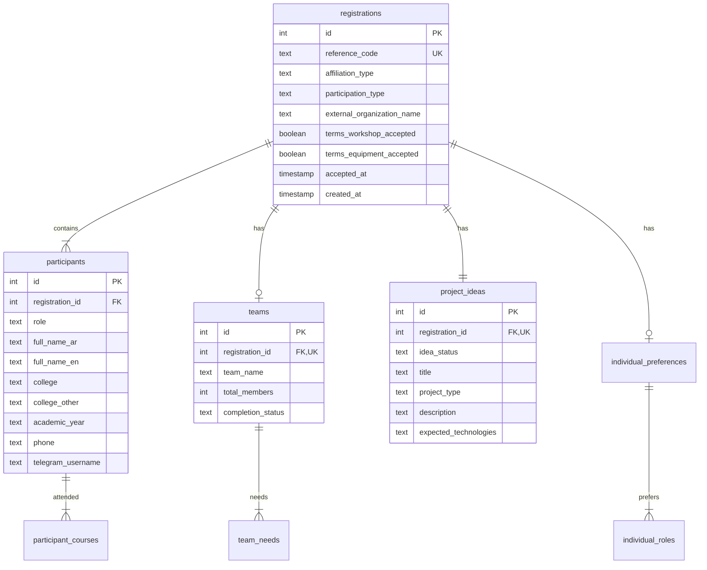

# تصميم قاعدة البيانات

## الكيانات

| الجدول | الغرض والعلاقات |
|---|---|
| registrations | الطلب، نوع الجهة والمشاركة، الرقم المرجعي، التعهدات، وقت التسجيل والموافقة |
| participants | قائد/عضو/فرد، بياناته الدراسية ووسائل التواصل؛ FK إلى الطلب |
| participant_courses | صف لكل دورة لكل شخص، وحقل اسم الدورة الأخرى عند الحاجة |
| teams | صف واحد على الأكثر لكل طلب فريق؛ العدد يشمل القائد |
| team_needs | صف لكل احتياج، أو الخيار الحصري لفريق مكتمل |
| individual_preferences | صف لكل تسجيل فردي، يتضمن اسم الصديق الاختياري |
| individual_roles | الأدوار التقنية المختارة؛ FK إلى تفضيلات الفرد |
| project_ideas | صف لكل طلب بحالة HAS_IDEA أو NEEDS_IDEA؛ حقول الفكرة فارغة للحالة الثانية |
| hmk_sessions | جلسات قصيرة الأجل مخزنة على الخادم |
| hmk_rate_limits | عدادات محاولات ذرية مشتركة بين نسخ التطبيق |

## القيود وضمانات الكتابة

تفرض PostgreSQL المفاتيح الخارجية و`ON DELETE CASCADE`، تفرد الرقم المرجعي، تفرد الفريق والفكرة
وتفضيلات الفرد لكل تسجيل، عدم تكرار دورة/احتياج/دور، قائد أو فرد واحد على الأكثر لكل تسجيل،
العدد بين 2 و6، شكل رقم الهاتف، التعهدين، وأن الجهة الخارجية فريق وله اسم جهة.
تفرض أيضاً وجود حقول فكرة HAS_IDEA وحدود كلمات وصفها.

القواعد العابرة للجداول، مثل تطابق العدد مع عدد الأشخاص فعلياً، وجود قائد واحد بالضبط، منع إنشاء
فريق للفرد، وضرورة HAS_IDEA للفريق الخارجي، تُفرض بواسطة Zod وخدمة الحفظ قبل إدخال البيانات.
تُكتب جميع الجداول في معاملة واحدة؛ لا توجد واجهة تعديل جزئي أو مسار آخر لإنشاء المشاركين.
من يكتب مباشرة عبر SQL مسؤول عن هذه القواعد العابرة للجداول؛ لا توجد triggers مخفية.

الحذف statement ذري على الطلب الأب؛ تُحذف جميع توابعه عبر FK cascades ولا تتأثر الطلبات الأخرى.
القراءة والتصدير يستخدمان معاملة repeatable-read لضمان صورة متسقة عند الحذف المتزامن.

## حالات الفكرة

`NEEDS_IDEA` سجل حالة صريح، لا فكرة تلقائية. عند اختياره لا تُحفظ حقول فكرة متبقية من خطوة سابقة.
`HAS_IDEA` يستلزم العنوان والنوع والملخص 50–300 كلمة والتقنيات. الخارجي لا يمكنه اختيار الحالة الأولى.

## الخصوصية

لا تُحفظ بيانات التسجيل في JSON. الاستثناء الوحيد هو حقل جلسة التشغيل الخاص بمكتبة الجلسات.
لا توجد سجلات نشاط إداري ولا حالات طلب ولا ملاحظات أو أدوار متعددة.
لا تُصدّر جداول الجلسات أو حدود المحاولات.
